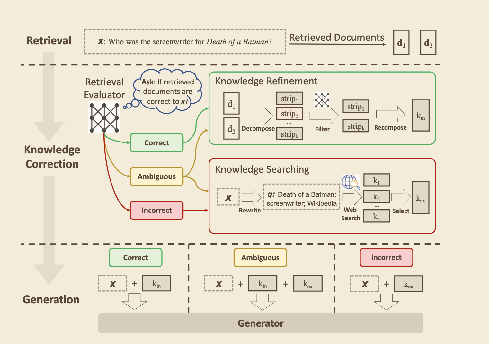
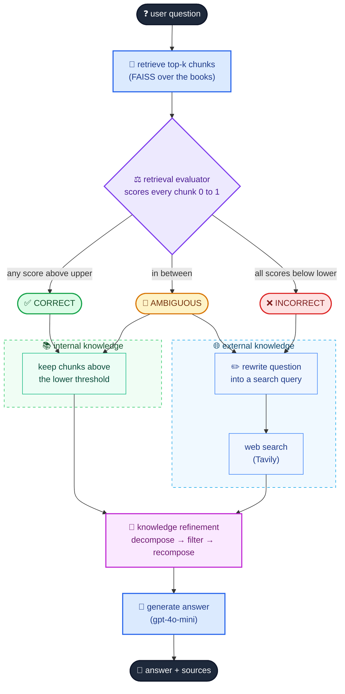

# Corrective RAG (CRAG)

Corrective RAG is a way to stop RAG from trusting its retriever blindly. Normal RAG takes the top-k chunks from the
vector store and hands them straight to the LLM, even when none of them are actually about the question. Then the
model either says "I don't know" or fills the gaps from its own memory.

CRAG adds a check in between. A **retrieval evaluator** scores every retrieved chunk against the question, and based
on those scores the system picks one of three actions:

- **CORRECT**: at least one chunk is clearly relevant. keep the good chunks and answer from them
- **INCORRECT**: nothing relevant. throw the chunks away, rewrite the question into a search query and answer from web results instead
- **AMBIGUOUS**: somewhere in between. use the good chunks and web results together

Whatever knowledge gets picked goes through **knowledge refinement** first (decompose into sentences, filter out the
irrelevant ones, recompose), so only the sentences that actually help reach the generator.

This repo is an implementation of CRAG from the paper:

> Shi-Qi Yan, Jia-Chen Gu, Yun Zhu, Zhen-Hua Ling. _Corrective Retrieval Augmented Generation_. 2024.
> [arXiv:2401.15884](https://arxiv.org/abs/2401.15884)

It's built up step by step in notebooks, starting from plain RAG and adding one piece of CRAG at a time.

## how it works

### CRAG in the paper

<p align="center">
  
</p>

<p align="center"><sub>Figure 2 from Yan et al., 2024, <a href="https://arxiv.org/abs/2401.15884">Corrective Retrieval Augmented Generation</a>.</sub></p>

The evaluator grades the retrieved docs. CORRECT refines them into internal knowledge (k<sub>in</sub>), INCORRECT
rewrites the question and searches the web for external knowledge (k<sub>ex</sub>), AMBIGUOUS uses both. The generator
gets the question plus whichever knowledge was picked.

### this implementation

Same flow, with the actual tools used here:



## notebooks

| #   | notebook                                   | what it adds                                                                 | paper         |
| --- | ------------------------------------------ | ---------------------------------------------------------------------------- | ------------- |
| 00  | `00_simple_rag.ipynb`                      | plain retrieve → generate, and where it fails                                | section 1     |
| 01  | `01_corrective_rag_correct_result.ipynb`   | retrieval evaluator (CORRECT / INCORRECT / AMBIGUOUS) + knowledge refinement | 4.2, 4.3, 4.4 |
| 02  | `02_corrective_rag_incorrect_result.ipynb` | query rewrite + web search, refining the web results too                     | 4.5           |
| 03  | `03_corrective_rag_ambiguous_result.ipynb` | book knowledge + web knowledge together                                      | 4.3           |
| 04  | `04_corrective_rag_full.ipynb`             | final graph + simple RAG vs CRAG                                             |               |

Every notebook uses the same 4 test questions so it's easy to compare how the behavior changes.

## what I found

- plain RAG with a strict "only use the context" prompt still leaked. asked to compare SVMs with XGBoost, it described
  XGBoost in detail while the word "XGBoost" appears 0 times in my books (and 0 times in the context it got)
- with CRAG, every XGBoost / LightGBM / transformer mention in an answer is backed by context that came from the web
- the evaluator prompt matters a lot. my first version gave half-relevant chunks a 0, so the AMBIGUOUS path never fired
- CRAG made about 36x more LLM calls than plain RAG on my test questions (still well under a cent with gpt-4o-mini).
  most of that is the per-sentence filter, which is why the paper uses a small fine-tuned model for it
- using gpt-4o-mini as a judge was noisy, a lot of false alarms. a simple term count was more trustworthy

## stack

- LLM: `gpt-4o-mini`, embeddings: `text-embedding-3-small` (both set in `.env`)
- vector store: FAISS, built once in 00 and saved to `vectorstore/`
- LangGraph for the pipeline
- web search: Tavily, with Wikipedia (MediaWiki API, no key) as an option since the paper prefers it

## where I differ from the paper

- the paper uses a fine-tuned T5-large (0.77B) as the retrieval evaluator and for filtering strips. the weights
  aren't released, so I prompt gpt-4o-mini instead. this ended up mattering more than I expected (see 01)
- the paper's evaluator scores from -1 to 1 with thresholds tuned per dataset (appendix B.3, e.g. 0.59 / -0.99 on
  PopQA). those are tuned to their T5, so I start with upper 0.7 / lower 0.3 on a 0 to 1 scale and check how
  sensitive the verdicts are
- strip filtering: the paper keeps the top 5 strips above a threshold, I do a yes/no per sentence
- the paper used Google Search and read full web pages. I use Tavily snippets
- for recent questions I use Tavily's date filter instead of only rewriting the query text

## setup

```bash
uv sync
cp .env.example .env   # add OPENAI_API_KEY and TAVILY_API_KEY
```

### books (put them in `data/`)

All free from the authors:

- _An Introduction to Statistical Learning with Python_ (ISLP, 2023): [statlearning.com](https://www.statlearning.com/), "Download the book PDF" (Python edition)
- _Pattern Recognition and Machine Learning_, Bishop (2006): [Microsoft Research page](https://www.microsoft.com/en-us/research/publication/pattern-recognition-machine-learning/)
- _Mathematics for Machine Learning_ (2020), optional: [mml-book.pdf](https://mml-book.github.io/book/mml-book.pdf)

None of them cover transformers, LLMs, XGBoost or recent news. That's on purpose, those gaps are what trigger the
INCORRECT and AMBIGUOUS paths.

### run

```bash
uv run jupyter lab
```

or open the notebooks in VS Code and pick the `.venv` kernel. Run 00 first, it builds the index (about $0.03 of
embeddings for all three books).
